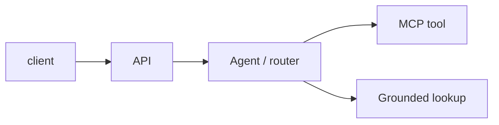

<!-- Change for your project: the diagram and module list below. Keep headings. -->
# Architecture

## Diagram

## Module boundaries
- services/<name>: API boundary, auth, validated JSON in/out
- agents/: router and tool calls, stub mode default
- docs/: this pack

## Data boundaries
State which fixtures stay separate (e.g. clinical vs marketplace) and why.
