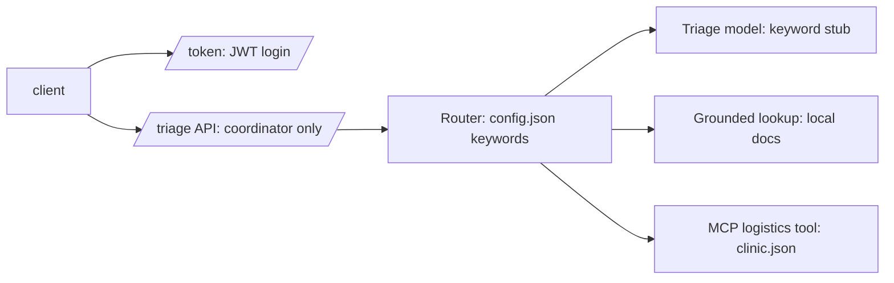

# Architecture

## Diagram

## Module boundaries
- `services/triage/`: API boundary, JWT auth with role check, validated JSON in and out (Pydantic).
- `agents/`: router and tool calls; stub mode is the default, so no live key is needed.
- `fixtures/`, `evals/`, `tests/`: synthetic data, golden-set eval, unit and security tests.
- `docs/`: this documentation pack.

## Data boundaries
Fixtures are synthetic and kept per domain. The triage fixture (clinical messages routed to triage, logistics or catalog) is not mixed with marketplace or catalog-image data, so clinical text never sits in the same file as listing data. No production data is scraped, and sensitive identifiers (phones, national IDs, M-Pesa codes, emails, bearer tokens) are redacted before anything is written to the audit log.